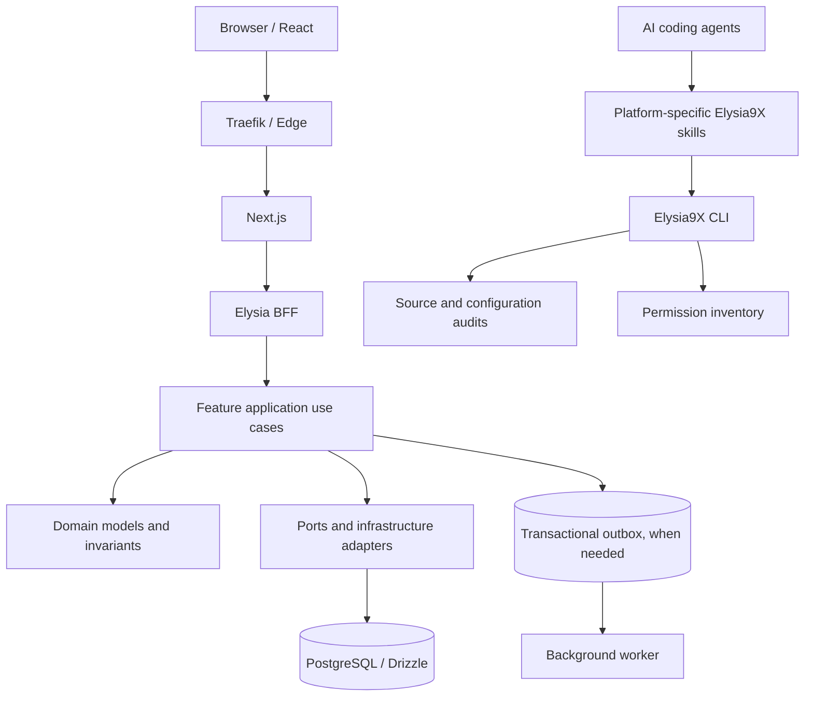

<div align="center">

# Elysia9X

### The Nine-Axis Engineering Standard for Production TypeScript Applications

**Architecture · Security · Automation · AI Coding Agents**

[](https://github.com/0xws/e9x/actions/workflows/ci.yml)
[](https://github.com/0xws/e9x/actions/workflows/codeql.yml)
[](https://github.com/0xws/e9x/actions/workflows/deploy-docs.yml)
[](./LICENSE)
[](https://github.com/0xws/e9x/commits/main)
[](https://bun.com)
[](https://www.typescriptlang.org/)

[Documentation](https://0xws.github.io/e9x/) · [CLI](./packages/cli) · [Plugins](./packages/plugins) · [Discussions](https://github.com/0xws/e9x/discussions) · [Issues](https://github.com/0xws/e9x/issues)

</div>

---

:warning: ***E9x plugins are currently impossible to install from npm. You can instead pull them from this repository instead directly. Sorryyyy!***

---

Elysia9X is an opinionated, executable engineering standard for building and operating production TypeScript applications—especially applications using **Bun, React, Next.js, Elysia, Eden Treaty and Drizzle**.

It combines a feature-oriented modular monolith with explicit architectural boundaries, BFF contracts, policy-based authorization, reliable data workflows, production deployment practices and governed AI coding-agent workflows.

It is more than a folder convention: Elysia9X aims to make important engineering rules **documented, testable and continuously auditable**.

> Organize software around business capabilities. Enforce boundaries through architecture. Make correctness executable. Give coding agents bounded responsibilities and verifiable permissions.

## Why Elysia9X?

Many architecture guides explain how a codebase should look. Elysia9X also provides tooling to inspect whether the project follows those conventions.

- **Feature-first:** code that changes together lives together.
- **Framework-independent domain:** business invariants do not depend on React, Next.js, Elysia or Drizzle.
- **Contract-driven BFF:** APIs serve application capabilities, not raw database tables.
- **Explicit authorization:** every endpoint is intentionally protected or explicitly reviewed as public.
- **Production-minded data:** transactions, constraints, migration safety and an outbox where needed.
- **Agent-ready:** feature ownership, specialized skills and independent review are part of the workflow.
- **Executable governance:** deterministic CLI checks find architectural drift and security-review gaps.

## The nine axes

| Axis | What it governs |
|---|---|
| **01 · Structure** | Feature ownership, vertical slices and dependency boundaries |
| **02 · Domain** | DDD, domain invariants and Hexagonal Architecture |
| **03 · Contracts** | Elysia, Eden Treaty, BFF, runtime schemas and DTOs |
| **04 · Security** | Authentication, authorization, CEL, RBAC/ABAC/ReBAC and tenant isolation |
| **05 · Data** | PostgreSQL, Drizzle, transactions, migrations and outbox patterns |
| **06 · Quality** | Unit, integration, contract, authorization and architecture tests |
| **07 · Operations** | Bun, containers, Traefik, environments and delivery pipelines |
| **08 · Reliability** | Observability, timeouts, retries, idempotency, backup and recovery |
| **09 · Intelligence** | AI coding-agent roles, skills, bounded ownership and review |

## Quick start

### Requirements

- [Bun](https://bun.com) **1.4.5 or later** for this repository.
- Git.
- Node-compatible tooling is used by a few documentation and ecosystem workflows, but Bun is the project runtime/package manager.

### Install the CLI

```bash
bunx --package @elysia9x/cli elysia9x init
bunx --package @elysia9x/cli elysia9x doctor
bunx --package @elysia9x/cli elysia9x scan
```

Run against a particular project:

```bash
bunx --package @elysia9x/cli elysia9x scan --cwd /path/to/project
bunx --package @elysia9x/cli elysia9x permissions audit --cwd /path/to/project --json
```

### Develop this monorepo

```bash
git clone https://github.com/0xws/e9x.git
cd e9x
bun install
bun run check
bun run dev
```

Run the local CLI:

```bash
bun run --filter @elysia9x/cli dev -- help
bun run --filter @elysia9x/cli dev -- scan --cwd /path/to/project
```

## Elysia9X CLI

The CLI is a Bun-native, deterministic project auditor. It is intentionally read-only by default.

```bash
elysia9x init
elysia9x doctor
elysia9x scan

elysia9x routes inventory
elysia9x permissions audit
elysia9x permissions audit --feature missions
elysia9x architecture audit
elysia9x database audit
elysia9x env audit

elysia9x report --format json --out .elysia9x/report.json
```

### Permission auditing

The permission auditor inventories statically discoverable endpoints by feature and compares them with `.elysia9x/permissions.json` and the policy registry. It can identify missing declarations, invalid policy references, stale or incomplete public reviews, orphan entries and missing authorization-test references.

Static discovery cannot prove that dynamic Elysia plugin composition, policy semantics, ownership checks or tenant isolation are correct. The CLI reports uncertain cases for human/runtime review; it never treats a missing policy as public access and never auto-grants permissions.

## Agent integrations

Elysia9X provides separate packages whose manifests and components follow each agent's supported integration format.

| Agent | Package | Format | Install |
|---|---|---|---|
| Claude Code | `@elysia9x/plugin-claude` | Claude rules and skills | `elysia9x integrations install claude` |
| Codex | `@elysia9x/plugin-codex` | Agent Plugins 1.0 + OpenAI extension | Codex plugin marketplace |
| Cursor | `@elysia9x/plugin-cursor` | Native Cursor Plugin | Cursor local plugin / repository marketplace |
| Mistral Vibe | `@elysia9x/plugin-vibe` | Agent Plugins 1.0 + Vibe extension | `elysia9x integrations install vibe` |

With the CLI installed, use:

```bash
elysia9x integrations list
elysia9x integrations install claude
elysia9x integrations install codex
elysia9x integrations install cursor
elysia9x integrations install vibe
elysia9x integrations install vibe --user
```

Installers preserve existing files by default. `--force` explicitly replaces plugin-managed files. Mistral Vibe's plugin support is experimental; verify compatibility with the Vibe release in use.


## Architecture at a glance



### Recommended deployment profiles

1. **Integrated application (default):** Next.js hosts the Elysia adapter; one deployable application and one application lifecycle.
2. **Independently deployed BFF:** Next.js and Bun/Elysia are separate services behind an edge router when independent scaling, deployment cadence or trust boundaries justify it.

Both profiles use the same internal feature architecture. Start with a modular monolith; extract services only for a measurable operational or domain reason.

## Engineering principles

1. Organize by business capability, not technical file type.
2. Keep domain rules independent of frameworks and infrastructure.
3. Validate every external input at runtime.
4. Expose intentional DTOs, never persistence models by accident.
5. Make every endpoint explicitly protected or intentionally public.
6. Authorize the specific resource and tenant on the server.
7. Fail closed when identity, policy or evaluation cannot be established.
8. Use transactions and database constraints for critical invariants.
9. Make migrations compatible with the deployment strategy.
10. Prefer deterministic checks for mechanical governance and agents for semantic review.
11. Keep coding agents within bounded feature ownership and use independent review.
12. Treat static analysis as evidence, never as proof of security.

## Project status

Elysia9X is under active development. The architecture and package contracts are documented, and the CLI and integrations are evolving. Audit completeness varies by rule: dynamic route registration, runtime authorization behavior and semantic policy correctness require integration tests and human review.

## Contributing

Contributions are welcome. Read [CONTRIBUTING.md](./CONTRIBUTING.md), follow [AGENTS.md](./AGENTS.md), run `bun run check`, and include tests and documentation for behavioral changes. For architectural changes, include an ADR explaining the context, alternatives and consequences.

## Security

Please report vulnerabilities privately as described in [SECURITY.md](./SECURITY.md). Do not open a public issue for an undisclosed vulnerability.

## License

MIT — see [LICENSE](./LICENSE).
