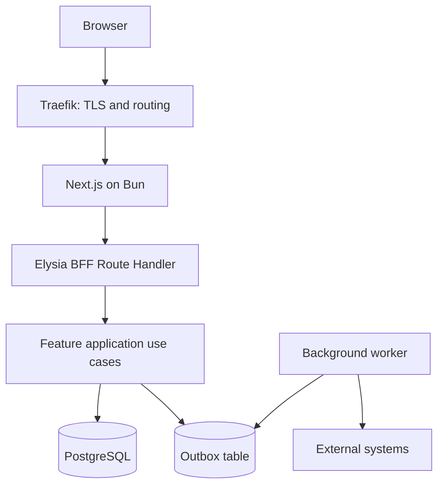
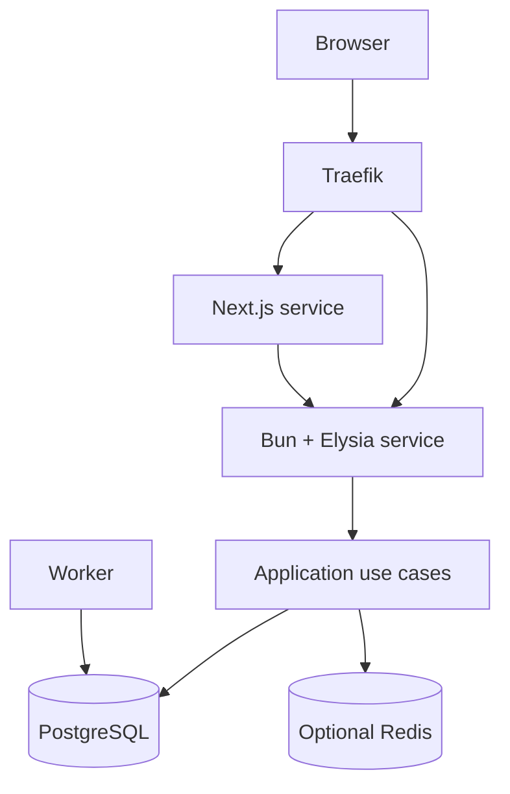

<!-- Generated from guide/architecture.md; edit the source document instead. -->

# Reference system architecture

Elysia9X combines Vertical Slice Architecture, Domain-Driven Design where useful, Hexagonal Architecture, a frontend-oriented BFF, selective CQRS, policy-as-code and transactional outbox patterns.

## Deployment profile A: integrated application



Use this profile when frontend and API share a lifecycle and operational boundary. Keep one authoritative API entry point. The current Elysia/Next.js integration should be checked against Elysia's current integration documentation; the documented Next.js pattern uses an optional catch-all route such as `app/api/[[...slugs]]/route.ts`.

## Deployment profile B: separately deployed frontend and API



Choose separate deployment when API scaling, deployment cadence, resource profiles, network boundaries or team ownership justify it. Do not split a modular monolith merely to claim microservices adoption.

## Technology responsibilities

| Technology | Owns | Does not own |
|---|---|---|
| Bun | Runtime, package manager, scripts and test runner | Domain design |
| TypeScript | Static type checking | Runtime validation |
| Next.js | Rendering, navigation and frontend composition | Authorization boundary |
| React | UI composition | Business persistence |
| Elysia | HTTP transport and BFF | Domain model |
| Eden Treaty | Typed client contract | Runtime security |
| Drizzle | Persistence adapter and migrations | Business invariants alone |
| PostgreSQL | Durable data and transactional consistency | Application orchestration |
| CEL | Policy expression evaluation | Authentication |
| Traefik | TLS and edge routing | Application permissions |

## Feature layout

```text
features/missions/
├── domain/
│   ├── entities/
│   ├── value-objects/
│   ├── services/
│   └── errors/
├── application/
│   ├── commands/
│   ├── queries/
│   ├── use-cases/
│   ├── ports/
│   └── dto/
├── infrastructure/
│   └── persistence/
├── transport/
│   ├── routes.ts
│   ├── schemas.ts
│   └── presenters.ts
├── ui/
├── tests/
└── index.ts
```

## Dependency rules

- Domain imports no frameworks, databases, HTTP or UI modules.
- Application depends on domain and ports, not concrete adapters.
- Infrastructure implements ports.
- Transport validates and maps HTTP concerns, then invokes use cases.
- Cross-feature imports use the target feature's public entry point.
- Composition roots wire adapters to application ports.

Do not create an interface for every function. Create ports at meaningful external boundaries such as repositories, clocks, payment providers, storage, identity, queues and policy evaluators.

## BFF contracts

Endpoints represent application capabilities rather than raw database tables. Validate external input at runtime, bound pagination and payload size, use explicit DTOs, define consistent errors and set downstream timeouts. Use Eden Treaty for internal TypeScript consumers where appropriate; use OpenAPI and generated clients when portable public contracts are needed.

## Optional patterns

Use CQRS when read and write paths have meaningfully different models or scaling needs. Use an outbox when a database transaction must reliably trigger external publication. Use Redis, queues and service extraction only for concrete requirements.
